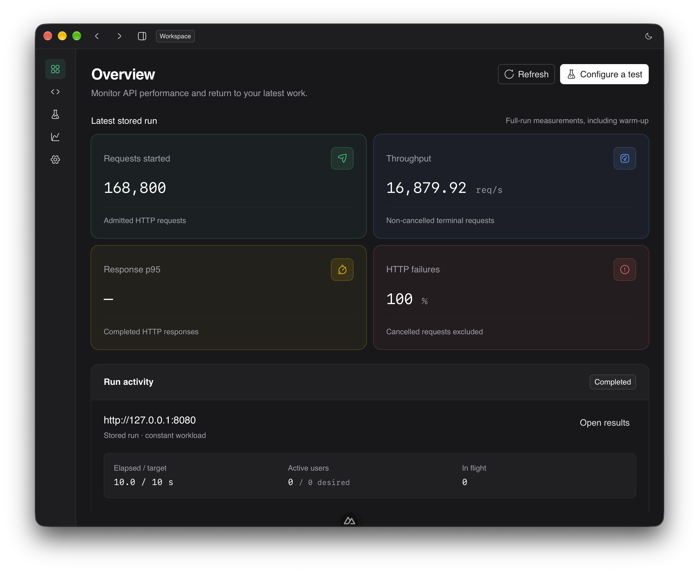
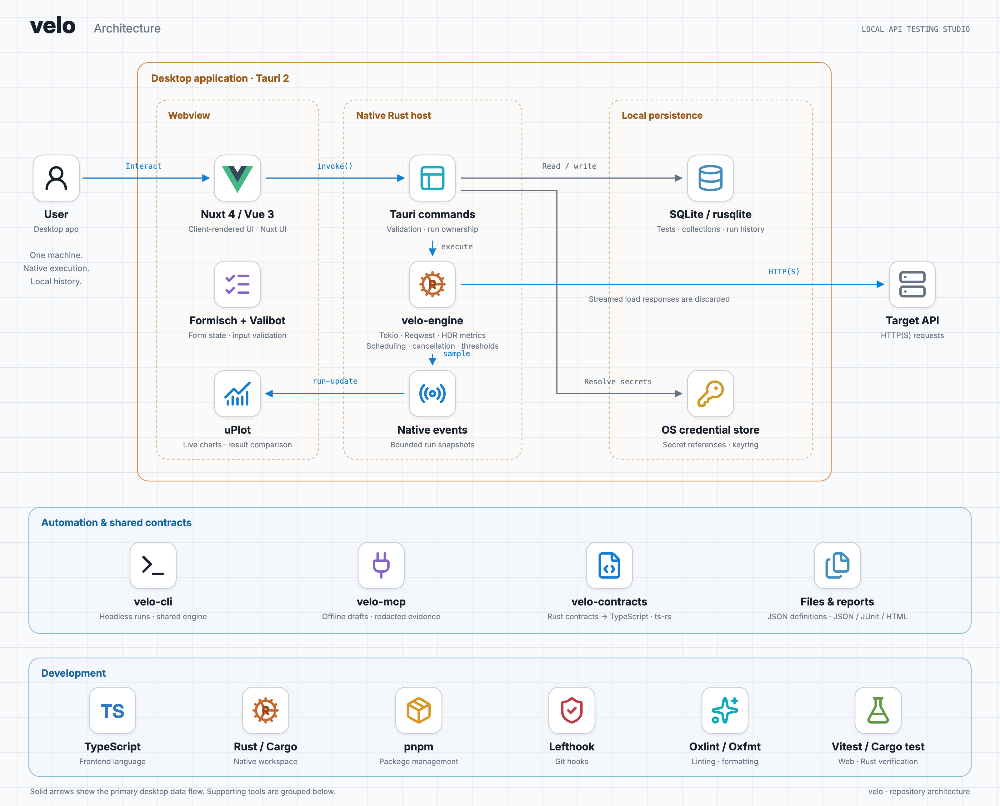

# Velo

Velo is a local desktop studio for testing HTTP APIs. Author requests and scenarios, run functional checks or load tests, inspect live measurements, and compare results saved on your machine. A Rust engine powers the desktop app and headless CLI.



## Workspaces

| Workspace         | Features                                                                                                                                                                                |
| ----------------- | --------------------------------------------------------------------------------------------------------------------------------------------------------------------------------------- |
| **Overview**      | Latest or active run, request counts, throughput, response p95, HTTP failures, run activity, recent history, and quick actions. Missing and partial measurements stay explicit.         |
| **API workspace** | Collections, nested folders, ordered requests, editable tabs, search, duplication, import/export, inherited defaults, environments, functional runs, sessions, and response inspection. |
| **Test studio**   | Visual and JSON editors, environments, scenarios, dataset preparation, single-request preview, load review, saved tests, imports, OS secret references, and optional AI drafting.       |
| **Results**       | Live and final measurements, assertions, thresholds, generator health, stored history, baseline comparisons, regression budgets, release context, and report exports.                   |
| **Settings**      | Light, dark, and system appearance; native connection diagnostics; AI provider, model, endpoint, and credential configuration.                                                          |

The sidebar remembers its collapsed state. The titlebar shows the active workspace and supports back/forward navigation through route history. Navigation preserves active execution and editable Test studio and API drafts.

## Requests, scenarios, and data

- Configure HTTP methods, ordered headers and query parameters, timeouts, pacing, redirects, protocol selection, and local resource budgets. Send text, JSON, URL-encoded forms, or multipart bodies with streamed file uploads.
- Use Basic, Bearer, or API-key authentication. API keys support header or query placement. The API workspace also supports OAuth client credentials and authorization code with PKCE, explicit token refresh, and forgetting stored tokens.
- Author multi-step scenarios with setup, load, and cleanup phases, weighted selection, assertions, extraction, and dependent request values.
- Edit versioned `velo.test.json` definitions visually or as JSON. Use shared variables, named environments, and `{{secret:name}}` references. Save and reopen definitions or export them for another machine or the CLI.
- Import supported cURL commands, OpenAPI 3 JSON operations, and Postman v2 JSON requests. Imports run offline and report fields that need manual configuration.
- Prepare seeded Faker recipes or mapped CSV/JSON records before execution. Configure locales, field dependencies, deliberate invalid values, record lifetime, allocation, and exhaustion behavior. Preview prepared records before running.
- Preview one request with explicit authorization, inspect its bounded response and assertions, then review the workload separately before starting load.

See [test authoring](docs/authoring.md), [datasets](docs/datasets.md), and [API collections and authentication](docs/api-workspace.md) for supported formats, limits, and workflows.

## Execution and measurements

- Run constant virtual users, staged VU ramps, or a constant arrival rate with bounded concurrency. Configure warm-up, scheduling duration, pacing, timeout, and graceful drain.
- Set final thresholds for response latency, HTTP failures, and request throughput. Configure automatic stop policies separately from final thresholds.
- Inspect live request and latency charts, HDR latency distributions, request outcomes, assertion results, scenario outcomes, and bounded failure diagnostics. Counts retain integer precision; missing observations remain unavailable.
- Monitor native-process and host CPU/RAM, requested and actual concurrency, arrival capacity drops, missed deadlines, and dataset pressure. Resource evidence describes the load generator, not the target server.
- Stop admission explicitly and drain active work. Cancelled, interrupted, incomplete, and integrity-limited runs retain their observed evidence and limitations.
- Keep local run history, inspect retained timelines, pin a baseline, compare compatible runs, review configuration differences, and apply regression budgets. Add release labels, Git context, tags, and notes.
- Export shared JSON v1, standalone HTML, and aggregate JUnit evidence. Comparison reports distinguish absolute thresholds from regression verdicts and unavailable comparisons.

Each desktop instance or CLI process runs one load test at a time. Velo executes HTTP requests; it does not provide browser automation or distributed load generation. See [execution](docs/execution.md), [generator health](docs/generator-health.md), and [comparison reports](docs/reports.md).

## Local data and credentials

SQLite stores run history, collections, and saved definitions locally. OS credential storage holds remembered secrets, OAuth tokens, and optional AI provider keys. Portable definitions use secret references; local upload bindings must be selected again after import.

API execution has separate bounded functional history with response-content retention available only when enabled. Load-run response bodies are streamed and discarded; explicit previews retain bounded content temporarily. Stored summaries remain until deleted, while live charts and retained time series have bounded samples.

Velo does not require an application account. HTTP and OAuth authentication configure access to the APIs being tested. See [persistence and credentials](docs/persistence.md) for storage, recovery, and retention details.

## Optional AI assistance and MCP

Configure OpenAI, Anthropic, Gemini, Ollama, or an OpenAI-compatible endpoint to draft tests and explain selected results. Review the frozen provider destination and redacted payload before every submission. Inspect and edit proposed definitions before applying them. AI suggestions cannot authorize targets, send previews, or start execution.

The separate `velo-mcp` stdio server provides authoring references, templates, offline imports and validation, explicitly granted redacted report evidence, and optional proposal files. It has no execution or credential tools and makes no model-provider calls. The connected MCP client controls model choice and cloud sharing.

See [AI assistance](docs/ai-assistance.md) and [MCP setup](docs/mcp.md).

## Headless CLI and CI

`velo-cli` runs exported definitions through the same Rust engine with explicit target authorization. It supports preparation without traffic, environment selection, secrets supplied over stdin or through the documented CLI inputs, prepared datasets, local upload bindings, baseline comparisons, and JSON/JUnit/HTML artifacts.

Exit statuses distinguish passing criteria, failed or unevaluable results, input/infrastructure failures, and interruption. Termination stops admission, drains work, and exports partial evidence when available. See [headless execution](docs/headless.md) and the [GitHub Actions example](docs/examples/headless-ci.yaml).

## Run locally

Install Node.js 26, pnpm 12, the Rust toolchain pinned in [rust-toolchain.toml](rust-toolchain.toml), and the [Tauri system prerequisites](https://v2.tauri.app/start/prerequisites/) for your platform.

```sh
pnpm install
pnpm dev
```

The development runner launches Nuxt and the native desktop shell together. Browser-only development can display and test the UI, but native execution, local history, and credential operations require the desktop shell. The headless CLI provides execution outside the desktop app.

## Run your first test

1. Open **Test studio → Request** and enter the URL of a target you are authorized to test.
2. Configure its HTTP method, headers, authentication, and body.
3. Choose a workload and scheduling duration. Start with a small virtual-user count.
4. Select **Review run**, inspect the target and requested load, then select **I am authorized. Start run**. The **Preview & run** section also provides single-request preview and **Review load** actions.
5. Watch the live charts or select **Stop run** to stop admission and drain active requests.
6. Open **Results** to inspect the summary, select historical runs for comparison, or export evidence.

Use **Library & secrets → Saved tests** to save the editable definition. Definitions retain literal request fields and non-secret environment values locally; use OS secret references for private values.

## Architecture



The application uses Tauri 2 with a client-rendered Nuxt 4/Vue 3 frontend. Rust owns HTTP execution, scheduling, bounded metrics, cancellation, and authoritative validation. TypeScript, Tailwind 4, Nuxt UI, Formisch, Valibot, and uPlot provide the frontend.

| Location                 | Responsibility                                                                        |
| ------------------------ | ------------------------------------------------------------------------------------- |
| `app/`                   | Workspaces, authoring, live monitoring, reports, and native client                    |
| `crates/velo-engine/`    | Desktop-independent Tokio/Reqwest execution and HDR metrics                           |
| `crates/velo-contracts/` | Shared contracts, reports, and TypeScript binding exporter                            |
| `crates/velo-cli/`       | Headless runner and CI report adapter                                                 |
| `crates/velo-mcp/`       | Offline authoring and selected redacted evidence over MCP                             |
| `src-tauri/src/`         | Native commands, run ownership, SQLite history, OS credentials, and desktop lifecycle |
| `app/types/contracts.ts` | Generated Rust-owned TypeScript contracts                                             |
| `docs/`                  | Usage guides, development instructions, and dated evidence                            |

## Verify and build

```sh
pnpm check
pnpm typecheck
pnpm test
pnpm build
pnpm lint
```

Install browser engines once to run the UI workflow and accessibility suite:

```sh
pnpm exec playwright install chromium webkit
pnpm test:ui
```

By default, Playwright generates and serves the static frontend. To test an existing development server without rebuilding or starting another server, provide its URL:

```sh
PLAYWRIGHT_BASE_URL=http://127.0.0.1:65432 pnpm test:ui --workers=3
```

Use the port of your running Nuxt server. Browser checks cover the UI in Chromium and WebKit; synthetic IPC fixtures do not replace native desktop acceptance.

Build on the target operating system. Installers are written under `target/release/bundle/`; on macOS, the application is `target/release/bundle/macos/Velo.app`.

Local acceptance evidence covers macOS. Windows/Linux CI is configured, while installation and interactive verification remain pending. Signing, clean-machine acceptance, and capacity measurements are separate [release gates](docs/release-readiness.md).

Read the [documentation index](docs/index.md), [development guide](docs/development.md), [CONTRIBUTING.md](CONTRIBUTING.md), and [SECURITY.md](SECURITY.md) for operating details, contributions, and vulnerability reports. Velo is licensed under [MIT](LICENSE.md).
