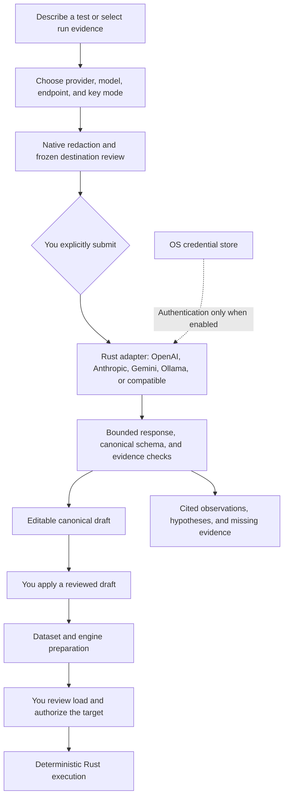

# AI assistance

Velo offers optional native assistance through OpenAI, Anthropic, Gemini, Ollama, and OpenAI-compatible services. The same review, redaction, canonical validation, evidence checks, and cancellation rules apply to every provider. Manual authoring, previews, datasets, execution, and reports work without AI setup.

## Configure a provider

Open **Settings**, select a provider, review its model and endpoint, and choose **Use provider configuration**. The same selector is available in the assistant. The selected configuration is shared across the current app session; keys remain in the OS credential store across restarts. Changing or editing the provider configuration invalidates an outstanding request review.

| Provider          | Native API                                                                                                                     | Authentication                                                          |
| ----------------- | ------------------------------------------------------------------------------------------------------------------------------ | ----------------------------------------------------------------------- |
| OpenAI            | Fixed `https://api.openai.com/v1/chat/completions`                                                                             | Stored API key; Bearer authentication.                                  |
| Anthropic         | Fixed `https://api.anthropic.com/v1/messages`                                                                                  | Stored API key; Bearer authentication with API version `2026-10-21`.    |
| Gemini            | Fixed `https://generativelanguage.googleapis.com/v1beta`, with the selected model appended to `models/{model}:generateContent` | Stored API key in the `x-goog-api-key` header.                          |
| Ollama            | Editable complete chat endpoint, default `http://localhost:11434/api/chat`                                                     | Keyless by default; optional endpoint-scoped Bearer key.                |
| OpenAI-compatible | User-supplied complete Chat Completions endpoint                                                                               | Stored endpoint-scoped Bearer key, or explicitly selected keyless mode. |

Model defaults are editable. Select an available model that can produce the requested JSON response. For Ollama, enter a model already available on your server; Velo does not pull models. Compatible services must support Chat Completions text responses and JSON mode. Compatibility does not include arbitrary vendor-specific headers, query-based authentication, or automatic protocol fallbacks.

Custom endpoints must use HTTPS. HTTP is accepted only on `localhost` or numeric loopback addresses. Endpoints cannot contain credentials, query parameters, fragments, or port zero. Remote self-hosted services need valid HTTPS certificates. Loopback requests bypass system HTTP proxies, and redirects are disabled for every provider.

For a keyed configuration, enter the key and choose **Store key securely**. Keys are isolated by provider and normalized endpoint under the `app.velo.ai` OS credential namespace. Changing a destination never forwards another endpoint's key. The form clears after saving, navigation, or a provider change. **Remove stored key** removes the selected destination's entry. Velo never reads a key back into the form or includes it in test definitions, model context, logs, or report exports.

Ollama and compatible services expose **Use the stored API key for this endpoint**. Disabling it skips credential-store access entirely, allowing a local keyless service to work without OS credential storage. Enabling it requires a stored key; unavailable credentials never cause an unauthenticated retry. Selecting a configuration or saving a key sends no test context.

OpenAI requests use `store: false`. Other providers retain their own data-handling policies. Velo sends no tool definitions, disables streaming, makes no automatic retries, and uses provider-specific response handling. There is no automatic fallback to another provider or endpoint.

## Native AI flow

## Draft a test

1. Open **Tests** and describe your endpoint, workload goals, assertions, or dataset. You can paste a non-sensitive API excerpt or example request into the description.
2. Optionally include the current definition's structural settings. Request URLs, headers, query values, bodies, auth, variables, environments, assertions, scenarios, and dataset values are excluded from this context.
3. Choose **Review provider payload**. Inspect the exact context and the list of excluded fields. This step does not contact the provider.
4. Choose **Send reviewed payload** to submit the frozen provider, model, destination, authentication mode, and context with Velo's fixed output instructions. Changing the description, provider configuration, selected context, or editor invalidates the review. Generation uses only the native review ID, so frontend changes cannot retarget an approved submission.
5. Review assumptions, missing inputs, unsupported requests, and the proposed definition. Compare it with the current definition, edit the proposal, then choose **Apply reviewed definition to editor**.
6. Supply missing inputs and use the existing dataset preparation, **Review load**, and target authorization flow before running.

Applying a suggestion preserves the editor's resource budgets. Canonical parsing and dataset validation reject unsupported formats and generators. The existing engine preparation checks still run before load authorization, including secret resolution, request validation, schedule validation, and local resource limits. An accepted AI response is not proof that a target exists or accepts the proposed request.

Dataset suggestions are recipes for the existing [test-data feature](datasets.md). Faker rows are prepared there; AI never runs in a request or virtual-user loop. AI has no execution tools and cannot send preview requests, authorize targets, start tests, or change an active run.

## Explain selected results

Open a historical run in **Results**, or its baseline comparison. Include the selected measurements and review the provider payload before submitting. Velo selects cumulative and evaluated metrics, measurement completeness, arrival pressure, host telemetry, available comparison deltas, and flags for restricted comparisons and configuration review. It omits request configuration, release metadata, history timelines, and response content.

Native redaction retains allowlisted numeric measurements and completeness flags. Supported metric names identify comparison deltas. Observation references are JSON pointers into the reviewed evidence, such as `/candidate/metrics/request_rate`. Velo rejects missing references and references to unavailable values. Follow a reference to inspect the reviewed payload. Hypotheses and suggested investigations appear separately from observations.

Model prose can still be wrong even when its references exist. Missing measurements, interrupted runs, sampling gaps, and absent target instrumentation limit conclusions. Aggregate client measurements do not establish a database or network bottleneck. AI explanations do not alter thresholds, regression verdicts, or exported reports.

## Privacy and failures

Descriptions and pasted API text are untrusted data. Velo removes credential-like lines, but it cannot recognize every secret in arbitrary prose. Review the remaining text before sharing it. Never paste resolved test secrets or credentials into the description. Referenced test secrets are never resolved for AI context. The selected provider key is also checked against the reviewed context, destination, model, and returned response before any sensitive value can become model input or provenance.

Reviews and suggestions stay in memory. Each review can be submitted once. Navigation, context changes, and cancellation discard owned review state and suppress stale responses. Cancellation stops the local request; it cannot recall content already received by the provider. The provider's data handling policies still apply.

Successful suggestions show the provider, requested configuration, returned model identity when supplied, destination, and generation time. Model output is not reproducible.

Requests have a 60-second network deadline, a 10-second connection deadline, and a 256 KiB response limit. Descriptions are limited to 32 KiB natively, selected evidence and total context to 128 KiB, and concurrent generation to one request. Invalid JSON, unsupported suggestions, truncated answers, missing credentials, and provider errors leave existing tests and results intact. Review and submit again after correcting the problem.
