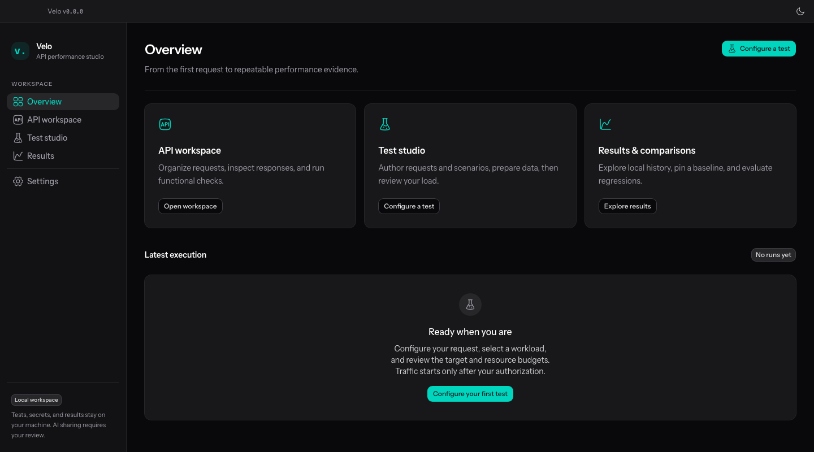
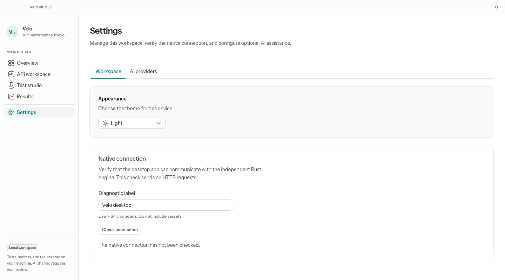

# UI migration evidence

The user approved the compact engineering studio direction for issue #20. Prerequisite completion and the final screen inventory are recorded in [Workspace interface](../../ui.md).

## Browser checks

At the initial migration checkpoint, `pnpm test:ui --workers=3` passed 70 checks across Chromium and WebKit against the generated static frontend. Checks cover:

- Formisch input and selection bindings, validation, and draft retention across sections and navigation.
- JSON editor sizing and monospace text after the control migration.
- Real CSV preparation and selecting the same filename again.
- Keyboard section navigation, confirmation-dialog focus, Escape dismissal, and focus restoration.
- Automated WCAG A/AA checks in light and dark themes at 640, 800, and 1440 pixels, including a 640 × 480 viewport. The desktop minimum was subsequently raised to 1000 × 800.
- Populated metrics and result tables, precise large-counter rendering, stopping controls, partial measurements, and theme changes at the native transport boundary.
- Keyboard access to horizontally scrollable result tables in the minimum window size.

The populated-result test supplies a synthetic native snapshot through an IPC fixture. It sends no target traffic and does not verify native IPC, OS credential dialogs, or actual engine execution. Those responsibilities retain their Rust regression coverage and require packaged desktop smoke checks for interactive acceptance. Automated accessibility checks do not establish full accessibility conformance.

After the Overview and shell updates, 12 Overview checks passed against the existing development server in Chromium and WebKit. These cover empty, live, stored, and unavailable-history states, plus accessibility in both themes. This focused run does not establish that the full browser suite passes after the shell changes.

## Screenshots

These screenshots predate the later Overview and shell updates and show the generated frontend in Chromium at 1440 × 800. They are browser evidence, not screenshots of the packaged native window.

The UI CI job runs the same browser suite on Ubuntu and retains screenshots and failure traces for seven days. Its configuration does not establish a successful remote run.
