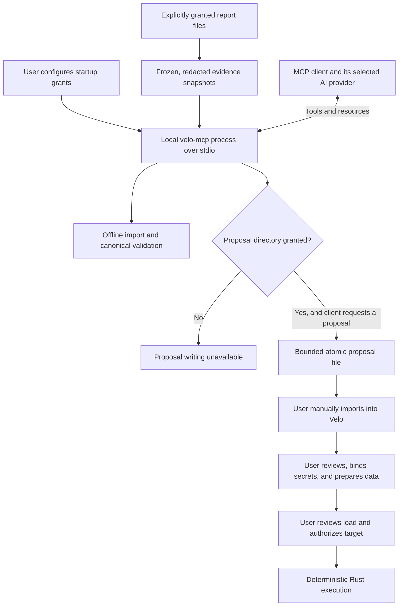

# MCP server

`velo-mcp` connects MCP clients to Velo's canonical authoring and selected, redacted result evidence. It runs as a local stdio process. It makes no model-provider calls and needs no AI API key. The connected MCP client chooses its model and controls any cloud sharing.

## MCP flow



MCP clients own model calls and cloud sharing. The server has no execution or credential tools. Proposal creation requires the startup directory grant; configure the client to request approval for that write.

## Connect a client

Build the standalone executable from the repository root:

```sh
cargo build --locked --release -p velo-mcp
```

Add it to your MCP client's server configuration. Use an absolute executable path; use `velo-mcp.exe` on Windows. A common configuration shape is:

```json
{
  "mcpServers": {
    "velo": {
      "command": "/absolute/path/to/velo/target/release/velo-mcp",
      "args": []
    }
  }
}
```

Your client's configuration location may differ. Restart or reconnect the client, then inspect the discovered tools. With no arguments, Velo exposes static authoring references, templates, imports, and offline validation. It shares no report files and enables no file writes.

Try asking:

> Read Velo's authoring reference and canonical types. Draft a one-user GET test for https://example.com/health with a supported status assertion. Validate it offline, disclose missing inputs, and show me the proposed JSON. Do not run it.

## Share selected results

Export a JSON v1 comparison report from Velo's Results page. A report produced by `velo-cli --json` uses the same shared format. Add each report explicitly to the server's startup arguments:

```json
{
  "mcpServers": {
    "velo": {
      "command": "/absolute/path/to/velo/target/release/velo-mcp",
      "args": ["--evidence", "/absolute/path/to/candidate-report.json"]
    }
  }
}
```

Selecting a report grants the connected MCP client access to its redacted measurements. The server loads and freezes a snapshot before initialization, assigns an opaque ID such as `report-1`, and discards the source text. Restart the process to share updated exports. The server never opens the desktop database, scans history, follows model-supplied file paths, or fetches referenced URLs.

`list_evidence` returns the granted IDs. `read_evidence` and `velo://evidence/report-1` return the same snapshot. Request configuration, URLs, release metadata, user labels, response content, and history timelines are omitted. Supported numeric measurements, completeness flags, comparison deltas, and a typed imported verdict remain available. Integer counters retain their decimal precision in the JSON text.

Imported reports are unverified evidence. The server does not authenticate their provenance or recompute derived values. Missing values stay unavailable; interrupted runs, measurement gaps, and restricted comparisons must be disclosed. Observation references should point into the returned snapshot, for example `/evidence/candidate/metrics/request_rate`. Separate observations from hypotheses and investigation steps. Client measurements do not prove database or network bottlenecks.

## Hand a proposal to Velo for review

Create a dedicated local directory yourself, then grant it at startup:

```json
{
  "mcpServers": {
    "velo": {
      "command": "/absolute/path/to/velo/target/release/velo-mcp",
      "args": ["--draft-directory", "/absolute/path/to/velo-proposals"]
    }
  }
}
```

The directory must already exist. Evidence and proposal arguments can be combined. Configure your MCP client to request approval for `propose_definition`, which writes a file.

Ask the assistant to validate the canonical definition, show the proposed changes, and call `propose_definition` after your review. Each accepted proposal gets a new `proposal-<uuid>.velo.test.json` file with private permissions where supported. Publication never overwrites an existing file. Resource budgets cannot exceed Velo defaults; lower requested limits are preserved. Known literal credentials are rejected in favor of `{{secret:name}}` references, and upload paths are cleared.

The tool returns the file path and validation status. In Velo, open **Tests → Import velo.test.json**, select the proposal, and inspect it in the visual or JSON editor. Bind secrets, select upload files, and prepare dataset rows through the existing controls. Then choose **Review load** and explicitly authorize the target before execution. Import is a manual handoff; the MCP server cannot open, apply, or execute a proposal inside the desktop app.

Treat proposal files as private test definitions. Credential-name checks cannot identify every secret or personal value hidden in arbitrary text. Do not supply resolved secrets to an AI client. Review the definition before requesting a file write. Velo's OS credential store and provider keys are never exposed through MCP.

Cancellation is checked before proposal writing and immediately before atomic publication. Cancellation after publication can leave a completed proposal file; inspect the directory before retrying. Cancelling a request never imports or executes a proposal. Temporary files are removed on ordinary write failures and pre-publication cancellation.

## Tools and resources

| Tool                  | Behavior                                                                                                                               |
| --------------------- | -------------------------------------------------------------------------------------------------------------------------------------- |
| `new_draft`           | Return the canonical version 1 template with default engine settings.                                                                  |
| `import_request`      | Convert supplied cURL, OpenAPI 3 JSON, or Postman v2 JSON offline; return editable candidates and warnings.                            |
| `validate_definition` | Parse the canonical definition, validate its dataset recipe, and run engine preparation when required non-secret inputs are available. |
| `list_evidence`       | List only the frozen reports granted at startup.                                                                                       |
| `read_evidence`       | Read a redacted report snapshot by its opaque ID.                                                                                      |
| `propose_definition`  | Publish a new canonical review file; available only with `--draft-directory`.                                                          |

Static resources are `velo://reference/contracts`, `velo://reference/authoring`, and `velo://reference/datasets`. The contracts resource contains the generated canonical TypeScript declarations used by the app. MCP tool parameter schemas describe their envelopes; `TestDefinition::parse` and the shared engine remain the authorities for test validity.

Validation returns `schema_valid`, `preparation`, and a stable `code`. A `ready` result means offline engine preparation succeeded. `needs_input` means secrets, unresolved variables, upload rebinding, or dataset records still require preparation in Velo. An `invalid` result requires correcting the definition. Validation never reads upload files, resolves OS or environment secrets, generates dataset rows, sends requests, or authorizes execution.

## Limits and troubleshooting

The server accepts one authoring operation at a time. Concurrent tool calls can return `MCP_BUSY`; wait for the active operation rather than retrying in a loop. Definitions are limited to 256 KiB, imports to 512 KiB and 32 candidates, incoming protocol lines to 1 MiB, and serialized tool payloads to 512 KiB. Each session permits at most eight proposals and 2 MiB of published draft content. Restarting resets the session quota; users manage retained proposal files.

At startup, the server accepts at most 16 regular report files, each at most 8 MiB, and retains at most 256 KiB per redacted snapshot. Symlink and nonregular report inputs are rejected; Unix reads also use no-follow and nonblocking flags. Missing files, unsupported report versions, malformed reports, and invalid proposal directories fail startup with a stable error code.

Initialization has a 30-second deadline. EOF, SIGINT, and SIGTERM on Unix close the local session. Malformed JSON and oversized protocol lines follow the SDK's bounded discard behavior; subsequent valid requests remain usable. Standard output carries MCP messages only. Standard error contains content-free startup or lifecycle failures. Internal programming panics abort with a fixed message that omits the payload.

If a tool is missing, check `tools/list` and the startup grants. If preparation needs input, finish that step in Velo. If the client reports an invalid parameter, inspect the advertised tool schema; unknown properties are rejected. The server offers no execution, preview, arbitrary filesystem, shell, SQL, credential, sampling, or remote HTTP tools.
